```
   ⠀⠀⠀⠀⠀⠀⢱⣆⠀⠀⠀⠀⠀⠀
   ⠀⠀⠀⠀⠀⠀⠈⣿⣷⡀⠀⠀⠀⠀
   ⠀⠀⠀⠀⠀⠀⢸⣿⣿⣷⣧⠀⠀⠀
   ⠀⠀⠀⠀⡀⢠⣿⡟⣿⣿⣿⡇⠀⠀
   ⠀⠀⠀⠀⣳⣼⣿⡏⢸⣿⣿⣿⢀⠀   C R U C I B L E
   ⠀⠀⠀⣰⣿⣿⡿⠁⢸⣿⣿⡟⣼⡆   An all in one local AI workshop.
   ⢰⢀⣾⣿⣿⠟⠀⠀⣾⢿⣿⣿⣿⣿
   ⢸⣿⣿⣿⡏⠀⠀⠀⠃⠸⣿⣿⣿⡿
   ⢳⣿⣿⣿⠀⠀⠀⠀⠀⠀⢹⣿⡿⡁
   ⠀⠹⣿⣿⡄⠀⠀⠀⠀⠀⢠⣿⡞⠁
   ⠀⠀⠈⠛⢿⣄⠀⠀⠀⣠⠞⠋⠀⠀
   ⠀⠀⠀⠀⠀⠀⠉⠀⠀⠀⠀⠀⠀⠀
```

**Crucible** builds software from a sentence, answers with the right expert
for each question, and gets, makes and measures the models it runs. Local
models do what they can, and frontier models do the heavy lifting once you
add a key. Nothing leaves the machine until you say so.

Website: https://msaunders.dev/crucible/

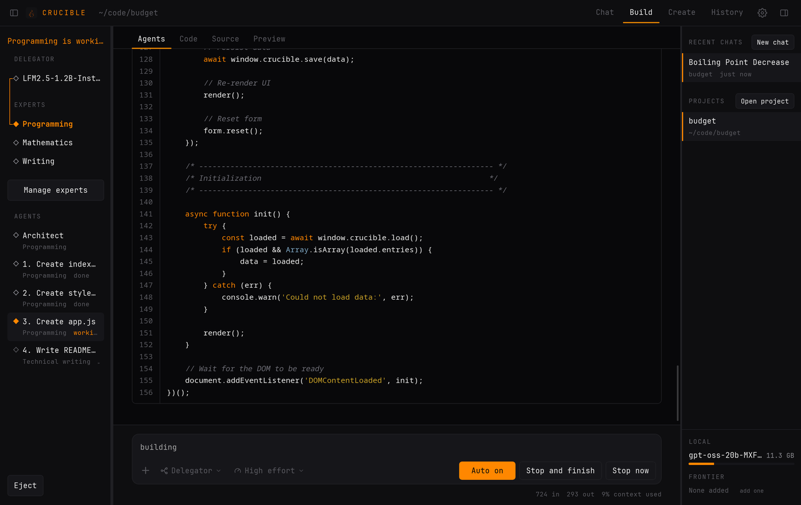

___
## Install

From the [releases page](https://github.com/mattsaund/Crucible/releases):

| | | |
|---|---|---|
| macOS | `Crucible-macOS.dmg` | drag into Applications |
| Windows | `Crucible-Setup.exe` | run it, no administrator needed |
| Linux | `Crucible-x86_64.AppImage` | `chmod +x`, run it |

Not signed with a paid certificate. On Windows, click **More info → Run
anyway**. On a Mac, open it once, then **System Settings → Privacy & Security →
Open Anyway**.

**The first start fetches the rest**, with progress shown and nothing to click:

- Crucible's own Python (no system Python needed or touched)
- the compute runtimes the machine can use (CPU, CUDA, Metal, Vulkan)
- the programs agents use, like GitHub's CLI, Node.js, a headless browser, Git
  on Windows and a text reader for pictures on Linux
- with no model at all, an open coding model sized to the machine (Qwen,
  Apache-2.0), seated as **Programming**
- the fine-tuner's environment

**Or build from source**

```sh
curl -fsSL https://raw.githubusercontent.com/mattsaund/Crucible/main/install.sh | bash
```

```powershell
irm https://raw.githubusercontent.com/mattsaund/Crucible/main/install.ps1 | iex
```

The options are `--prefix DIR`, `--jobs N`, `--check`, `--no-deps`,
`--no-trainer`, `-y` and `--uninstall`. Run from inside a clone, it builds that
clone.

**Updating:** Settings → About → **Update now**, or run the installer again.
Crucible checks GitHub once a day and says when there is one. Config, models
and history are kept. Versions are tagged `v0.9.5`, and what changed is in
[CHANGELOG.md](CHANGELOG.md).

**Uninstall:** `crucible --uninstall`. It asks before deleting models. If the
program will not run, use one of these.

```sh
curl -fsSL https://raw.githubusercontent.com/mattsaund/Crucible/main/install.sh | bash -s -- --uninstall
```

```powershell
& ([scriptblock]::Create((irm https://raw.githubusercontent.com/mattsaund/Crucible/main/install.ps1))) -Uninstall
```

___
## What it does

### Ask or build

- **One box.** Ask a question and the right expert answers it. Ask for
  software, like "a budgeting app that charts my gross and net revenue", and it
  becomes a build. There is no mode to pick.
- For a build, the architect writes a plan. Type *go*, or what to change.
- Agents take the tasks side by side, each the expert that fits it. When
  nobody on the roster fits, the build adds one and keeps it.
- **Frontier and local together.** Large tasks go to a provider's model, small
  ones to a model on this machine.
- Each finished task is committed. A check runs at the end, and the architect
  writes up what was built.
- **A change is a sentence.** "Make the button blue" is one task, made and shown.
- The **agents** are listed under the experts in the side menu. Click one for
  its task, its steps and its code.
- The build is a turn of the conversation, so "now add dark mode" knows the
  project. Ask something else while it runs, and it answers beside it.

### Code

- **An editor** beside the conversation, with tabs, a file tree, find and replace,
  search across the project, Ctrl+P to open a file by a few letters, and a
  terminal.
- A file an agent changes while it is open reloads. Unsaved work is never
  written over.

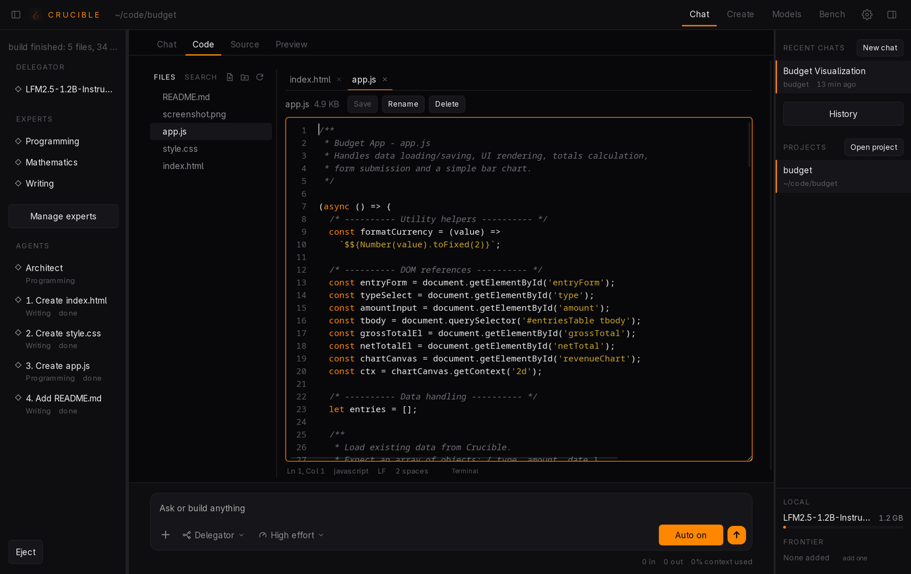

### Preview, tune, ship

- **Preview** shows the page being built and reloads as agents write it.
- **Pick an element**, then nudge padding, margin, fonts, colors and more.
  **Apply to source** writes the change into the stylesheet.
- **Make it an app**, a program of its own in Applications, the Start menu or
  the applications menu. It runs without Crucible and keeps its own data.
- **Source** is git, with changes, diffs, commits, pull, push, history and CI
  runs. **Publish to GitHub** and **Ship** a release with `gh`.

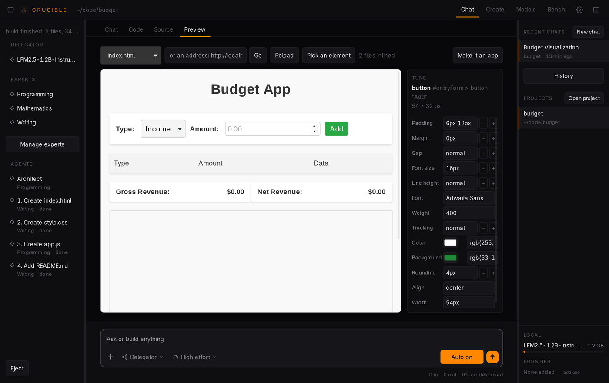

### Experts

- **A roster of experts.** A small router model, the delegator, sends each
  prompt to the expert that fits. It scores the roster, so it cannot name one
  that does not exist.
- Pin a prompt to one expert from the box, or with `/name`.
- Replies show Markdown, code and math, typeset from LaTeX.
- **Providers** are Anthropic and anything that speaks the OpenAI API, like
  OpenAI, Gemini, DeepSeek, Kimi, OpenRouter, Groq or a server on your network.
- The corner of the right-hand panel shows the models in memory, and the
  frontier model's tokens, cost at list prices, rate limits and context.

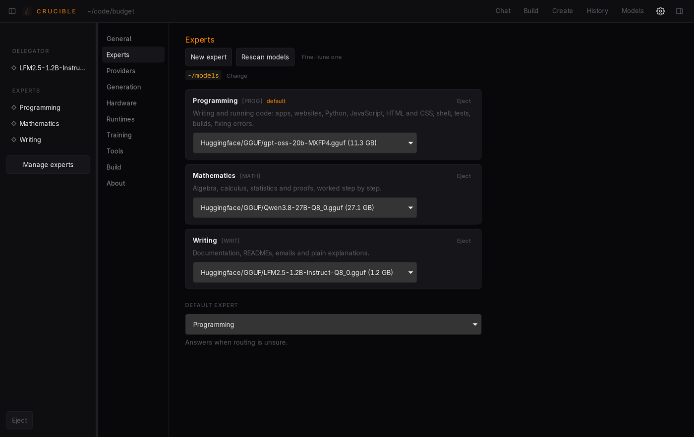

### Tools

Every model, local or not, gets the same tools in a trusted folder:

- LIST, READ, FIND, WRITE and EDIT **files**, PDFs, Word, sheets and pictures
  too
- RUN **commands** in any shell, and PYTHON, GIT, GH, and START, LOGS and STOP
  for servers
- SEARCH **the web** (DuckDuckGo, no key) and FETCH pages in a headless browser
- RENDER an HTML page or SVG to PDF or PNG
- TOOL calls any MCP server added in Settings
- SCREENSHOT, CLICK, MOVE, TYPE, KEY and SCROLL on **this computer**, off by
  default
- Edits wait for your OK unless Auto is on. RUN is not a sandbox.

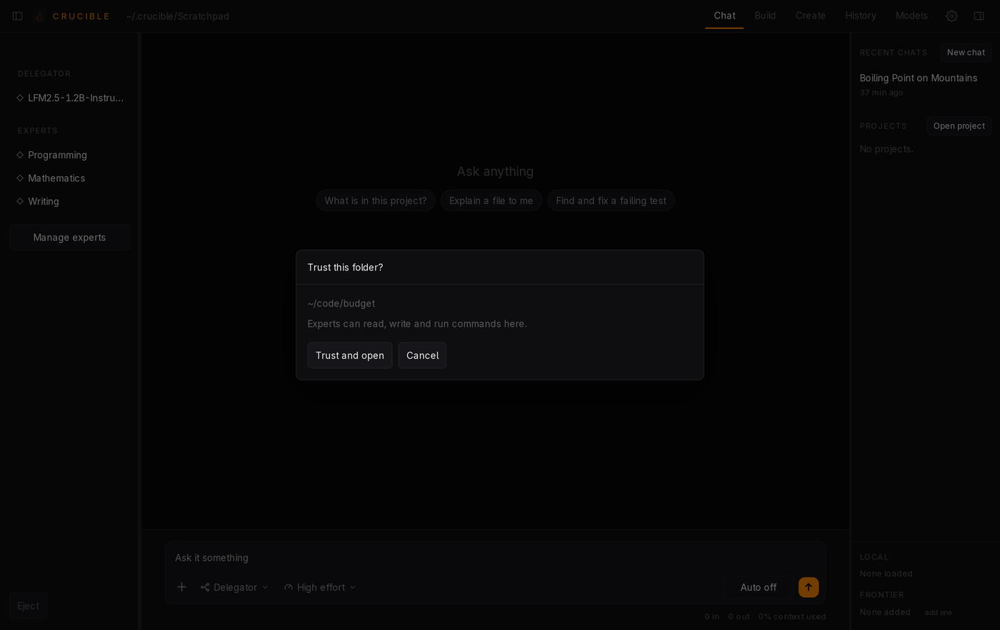

### Attach

- Attach documents, code, pictures and folders with **+**, Ctrl+U, or by
  dropping them on the window. Paste a picture with Ctrl+V.
- PDFs, Office files, EPUB and text are read into the prompt. Pictures go to
  models that see, and the others get the words in them.

### Models

- **Download from Hugging Face** in **Models**. Search, sort by best match,
  downloads, likes or recently updated, pick GGUF or MLX and a quantization,
  and see whether it fits on the cards, runs partly on the CPU, or is too
  large. Downloads carry on after a dropped line or a restart and are checked
  against Hugging Face's checksum.
- Each result shows its maker's logo, the original maker's for a repack.
- GGUF everywhere, MLX on Apple Silicon. LM Studio and Hugging Face folders
  work as they are.
- Models that see pictures work when their `mmproj` projector sits beside them.
- A model is in memory only while something uses it. Several stay loaded when
  memory allows, and one in use is never freed.

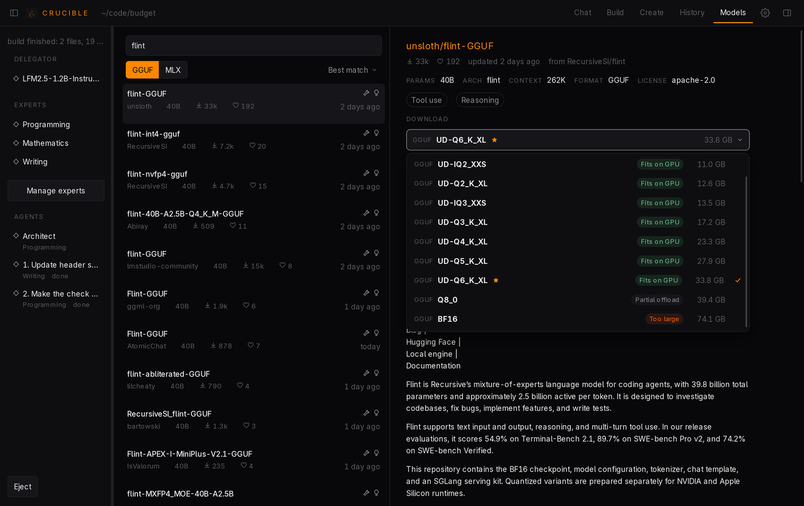

### Create

- **Fine-tune an expert.** Pick a base model and data, train it on your card
  (LoRA, or QLoRA with CUDA), test it and keep it. A tenth of the data is held
  out and scored before and after, so you see what training did.
- **Condense a model.** A Q8 that does not fit becomes a Q4 that does, and the
  largest models go down to IQ2 or IQ1, made after a pass over sample text that
  finds the weights that matter most. Every size is measured first and marked
  by how it fits.
- Builds keep what frontier models did as data to teach local ones.

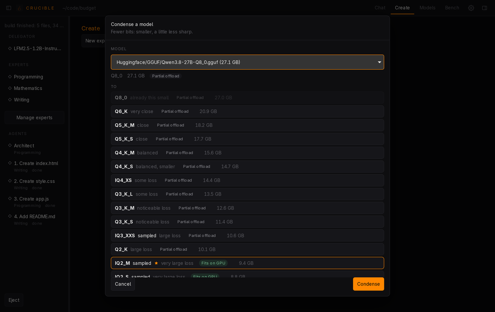

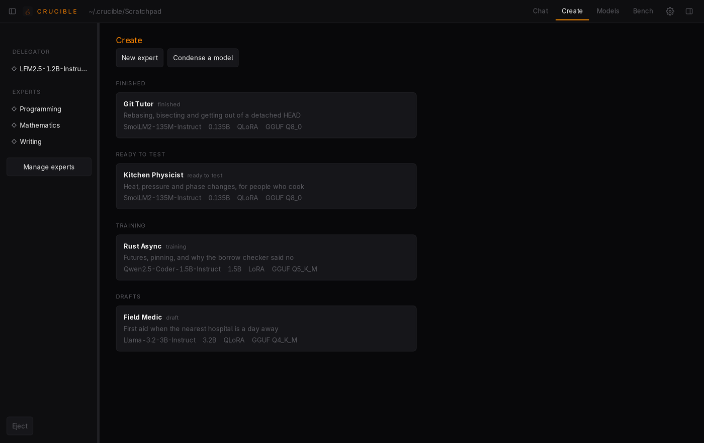

### Bench

- **Bench opens on the [public board](https://github.com/mattsaund/crucible-bench).**
  The best local models come first, each with a Download that opens it in
  Models, then the spider chart, then every result there is, searchable.
- **Add benchmark** runs your models through nine benchmarks in seven skills
  (MMLU-Pro, ARC-Challenge, GSM8K, MATH-500, HumanEval, MBPP, IFEval,
  HellaSwag and TruthfulQA). Quick asks 50 items of each, Standard 200, Full
  every one.
- Every Crucible asks the same items the same way, so a score from one machine
  stands beside a score from another.
- **Spider charts** compare up to three models. A result opens to every
  benchmark, its margin of error, and the answers that were wrong.
- **Post** a result from your GitHub account. A result is names and numbers,
  nothing typed, and its model has to be a public file on Hugging Face.
- **Bench vs base** puts a fine-tune beside the model it was made from.
- HumanEval and MBPP run the code a model writes on this machine, with time
  and memory limits. It is not a sandbox.

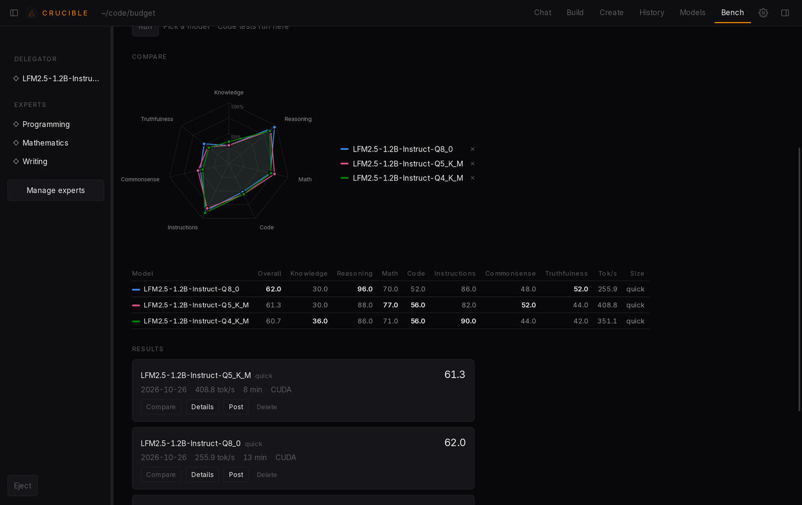

### Serve

- **Serve a model to other programs**, the way LM Studio does. Turn it on in
  Settings, Server, pick the delegator or any model here, and point any OpenAI
  client at the address it shows.
- It answers on this machine only, or on your network when you say so. An
  API key is optional.
- Chats and builds keep working while it serves. A request waits its turn.
- It listens only while it is on.

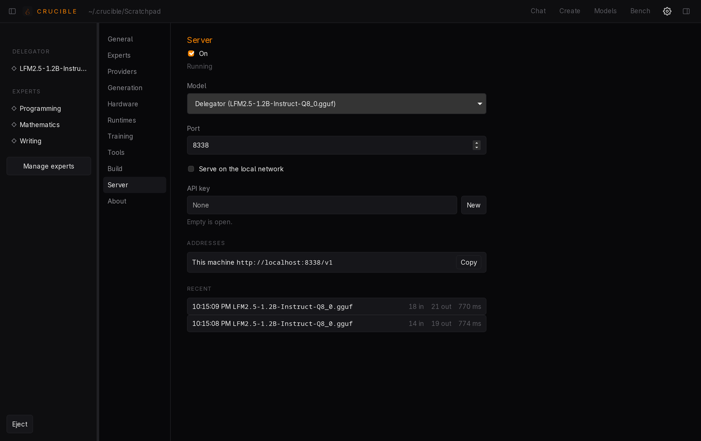

### Hardware

- Runtimes (CPU, CUDA, Metal, Vulkan) install from Settings, downloaded or
  compiled. A downloaded CUDA runtime needs only the NVIDIA driver, 580 or
  newer.
- Several GPUs work as one, split automatically, evenly, by priority, or kept
  to a single card.

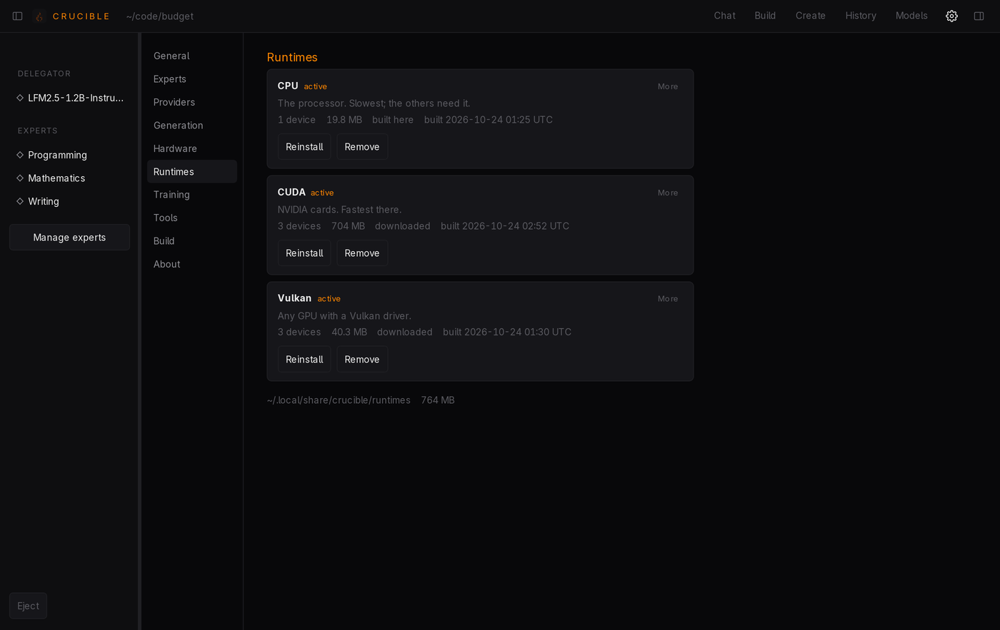

### History

- History is per project, in the right-hand panel, and a reopened chat carries
  on where it stopped.
- A chat with no project gets a folder of its own in `~/.crucible/Scratchpad`
  (hidden). The right-hand panel lists recent chats and projects.

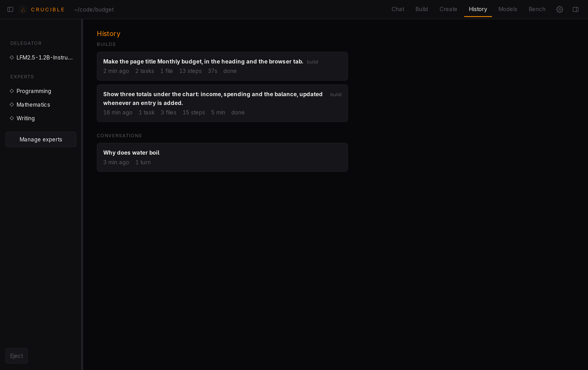

___
## Settings and keys

Everything is in Settings and applies at once. The file is
`~/.config/crucible/config.json`, or `%APPDATA%\crucible\config.json` on
Windows.

- Ctrl+1 to 4 open Chat, Create, Models and Bench.
- Ctrl+, opens Settings, and Ctrl+U attaches.
- In the editor, Ctrl+P opens a file, Ctrl+Shift+F searches the project, Ctrl+S
  saves, Ctrl+F finds, Ctrl+H replaces and Ctrl+G goes to a line.

___
## Build from source

C++20, CMake 3.24+, git, and on Linux WebKitGTK (`libwebkit2gtk-4.1-dev` on
Debian and Ubuntu, `webkit2gtk4.1-devel` on Fedora). Dependencies are fetched
and pinned. The tests want Python 3.10+ on PATH (or `CRUCIBLE_PYTHON`).

```sh
cmake -B build -DCMAKE_BUILD_TYPE=Release
cmake --build build -j$(nproc)
sudo cmake --install build --component crucible
```

___
## Contributing and AI policy

I am open to AI and agentic coding, but the code written needs to follow
specific guidelines:

1. MUST be human readable, acceptable variable/function names.
2. Easily traceable, following a good program flow.
3. Contributor MUST look at/document code and code changes. You need to
   understand the code that is being written.

Every push is built and tested on Linux, macOS and Windows.
[docs/testing](docs/testing/README.md) says how to test a change or a release.

___
## License

MIT, see [LICENSE](LICENSE). What is compiled in is listed in
[THIRD_PARTY.md](THIRD_PARTY.md), and `crucible --licenses` prints the notices.

Some things are fetched rather than shipped, each under its own license.
Crucible's Python (PSF License), the fine-tuner (mostly Apache-2.0, BSD and
MIT, with NVIDIA's proprietary CUDA libraries on NVIDIA machines), the agents'
programs, the starter model (Apache-2.0), the benchmarks' questions and every
model's weights.

Provided "as is", without warranty. You are responsible for what your models
read, write and run.
